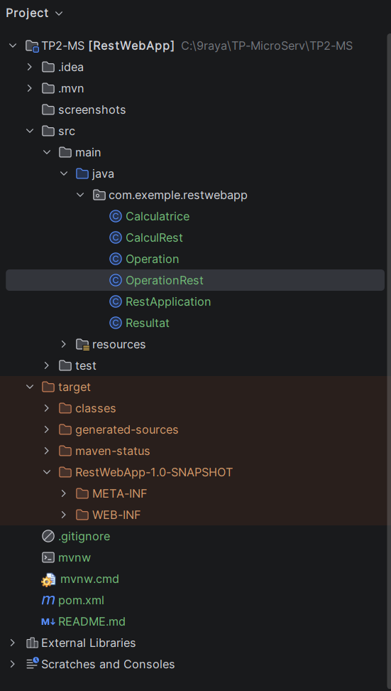
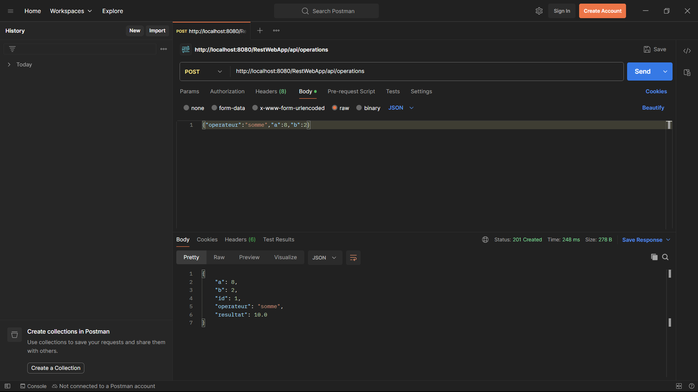
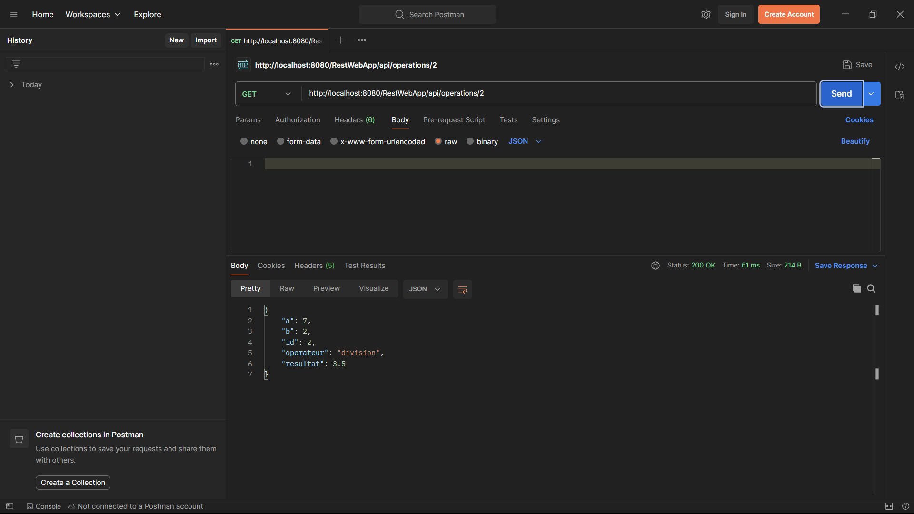
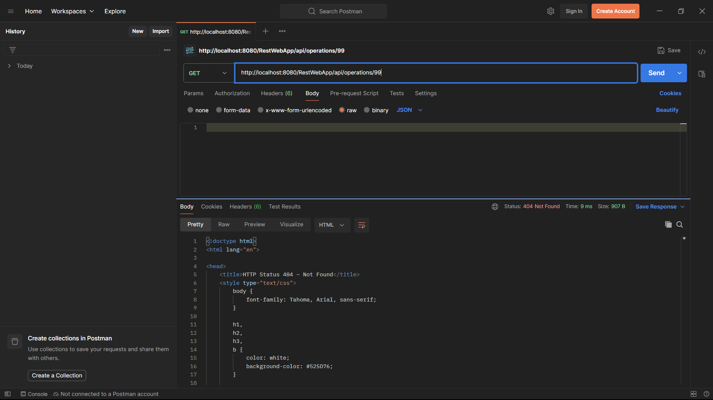
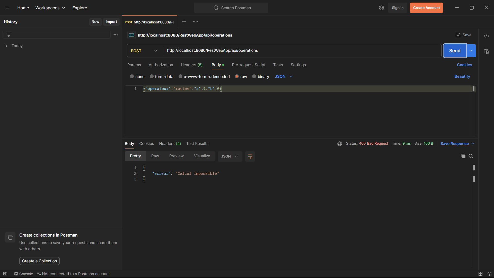
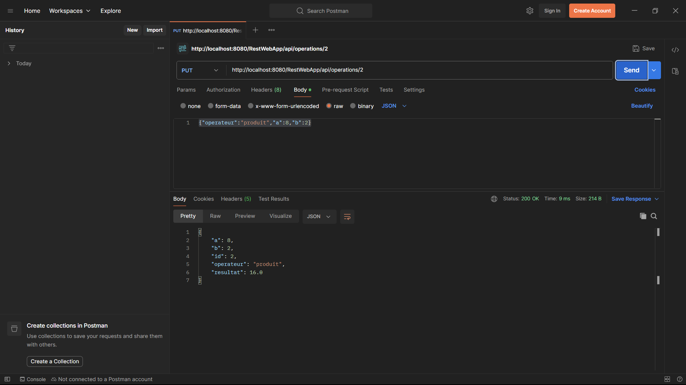
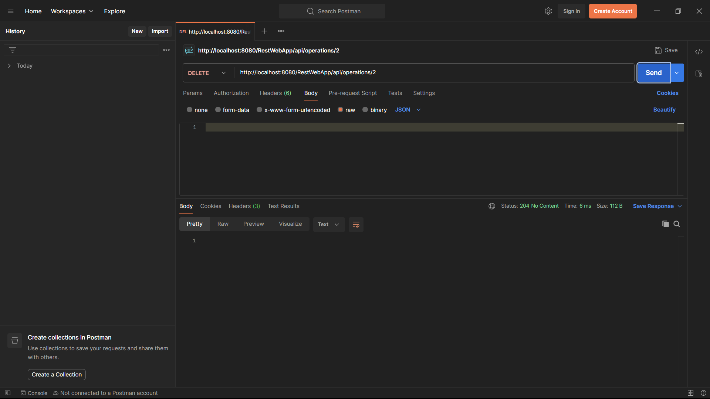

## 1. Architecture et Structure du Projet

Le projet `RestWebApp` est une application web Maven (`packaging: war`) déployée sur **Apache Tomcat 10.1** et basée sur **Jakarta EE 10 (JAX-RS / Jersey 3.1.9)**.


*Figure 1 : Structure du projet Maven `RestWebApp` dans IntelliJ IDEA.*

---

## 2. Partie A : Conception du service (Questions A.2)

**1. Pourquoi les calculs directs utilisent-ils le verbe GET et non POST ?**
Les calculs directs se contentent de demander un résultat à partir des paramètres fournis sans modifier l'état du serveur ni enregistrer de ressource (opération **sûre** et **idempotente**), ce qui correspond exactement à la sémantique du verbe HTTP `GET`. Le verbe `POST` est réservé à la création d'une nouvelle ressource sur le serveur.

**2. Dans l'URI `/calcul/somme?a=2&b=3`, comment s'appelle la partie située après le point d'interrogation ?**
Elle s'appelle la **chaîne de requête** (*Query String*), composée de **paramètres de requête** (*Query Parameters*) sous la forme `clé=valeur` séparés par `&`.

**3. Quelle différence y a-t-il entre `/operations` et `/operations/3` ?**
`/operations` désigne la **ressource collection** (l'ensemble de toutes les opérations enregistrées), tandis que `/operations/3` désigne une **ressource individuelle** précise identifiée de manière unique par `id = 3` au sein de cette collection.

**4. Quel code de statut HTTP le serveur doit-il renvoyer si le client demande `/operations/99` et que cette opération n'existe pas ?**
Le serveur doit renvoyer le code de statut HTTP **`404 Not Found`** (Ressource non trouvée).

---

## 3. Partie C : Premier service REST (Question C.1)

**Question C.1. Remplacez GET par POST dans Postman sur `/api/calcul/somme?a=2&b=3` et renvoyez la requête. Quel code de statut obtenez-vous ? Expliquez-le.**
On obtient le code de statut **`405 Method Not Allowed`** (Méthode non autorisée). En effet, l'URI `/api/calcul/somme` existe bien sur le serveur, mais la méthode Java correspondante n'est annotée qu'avec `@GET` : aucune méthode ne gère le verbe `POST` pour ce chemin.

---

## 4. Partie D : Compléter la calculatrice (Questions D.1, D.2, D.3)

### Observations D.3
* Requête 1 : `GET /RestWebApp/api/calcul/somme?a=2` (sans `b`) $\rightarrow$ Statut **`200 OK`**, Corps : **`2`**.
* Requête 2 : `GET /RestWebApp/api/calcul/somme?a=abc&b=3` $\rightarrow$ Statut **`404 Not Found`** (ou `400 Bad Request` selon la configuration Jersey pour une erreur de conversion de type).

**Question D.1. Quelle valeur JAX-RS donne-t-il à un paramètre entier absent ?**
Lorsqu'un paramètre de requête associé à un type primitif `int` est absent de l'URI, JAX-RS lui attribue la valeur par défaut du type primitif en Java, c'est-à-dire **`0`** (d'où $2 + 0 = 2$).

**Question D.2. Quel statut obtenez-vous lorsque le paramètre n'est pas un entier ? La méthode `somme` a-t-elle été exécutée ?**
On obtient un statut d'erreur client (**`404 Not Found`** dans Jersey par défaut lors d'un échec de conversion de `@QueryParam`/`@PathParam` vers `int`). La méthode `somme` **n'a pas été exécutée** car l'erreur se produit en amont, au moment où Jersey tente de convertir la chaîne `"abc"` en entier `int` avant d'appeler la méthode Java.

**Question D.3. Quelle différence y a-t-il entre `@QueryParam` et `@PathParam` ? Laquelle de ces deux annotations utilisera-t-on pour lire l'identifiant dans `/operations/{id}` ?**
* `@QueryParam` extrait une valeur située dans la *Query String* après le `?` (ex: `?a=6&b=7`), généralement utilisée pour filtrer ou paramétrer un calcul.
* `@PathParam` extrait une variable directement intégrée dans un segment du chemin de l'URI défini par `{...}` (ex: `/produit/{a}/{b}`).
* Pour lire l'identifiant dans `/operations/{id}`, on utilisera **`@PathParam("id")`** car `{id}` fait partie intégrante du chemin identifiant la ressource.

---

## 5. Partie E : Échanger des données en JSON (Questions E.1, E.2)

**Question E.1. Vous n'avez écrit aucune ligne de code pour fabriquer ce texte JSON. Qui a effectué la conversion ? D'où viennent les noms `a`, `b`, `operation` et `resultat` ?**
* La conversion (sérialisation) de l'objet Java `Resultat` en texte JSON a été effectuée automatiquement par **Jersey** grâce à la dépendance **`jersey-media-json-binding` (JSON-B)** déclarée dans le `pom.xml`, déclenchée par l'annotation `@Produces(MediaType.APPLICATION_JSON)`.
* Les noms des clés JSON (`a`, `b`, `operation`, `resultat`) proviennent des noms des **accesseurs publics (getters)** de la classe `Resultat` (`getA()`, `getB()`, `getOperation()`, `getResultat()`) selon les conventions JavaBeans.

**Question E.2. Pourquoi la seconde requête (`Accept: application/xml`) est-elle refusée avec le code `406 Not Acceptable` ?**
Parce que le client exige via l'en-tête `Accept: application/xml` une réponse au format XML, alors que la méthode `sommeDetail` est annotée avec `@Produces(MediaType.APPLICATION_JSON)` et ne sait produire que du JSON. Le serveur renvoie donc **`406 Not Acceptable`** pour indiquer qu'il ne peut pas fournir de représentation dans le format demandé par le client.

---

## 6. Partie F : Tests de la ressource `/operations` (F.3, F.4, F.5)

### F.3 Série de tests (Création `POST` et Lecture `GET`)

#### Test 1 : `POST /operations` (Somme valide)
* **Requête :**
```bash
curl -i -X POST -H "Content-Type: application/json" -d "{\"operateur\":\"somme\",\"a\":8,\"b\":2}" "http://localhost:8080/RestWebApp/api/operations"
```
* **Statut obtenu :** `201 Created` (avec en-tête `Location: http://localhost:8080/RestWebApp/api/operations/1`)
* **Corps obtenu :**
```json
{"a":8,"b":2,"id":1,"operateur":"somme","resultat":10.0}
```

*Figure 2 : Test 1 — Création d'une opération de somme (`201 Created`).*

---

#### Test 2 : `POST /operations` (Division valide)
* **Requête :**
```bash
curl -i -X POST -H "Content-Type: application/json" -d "{\"operateur\":\"division\",\"a\":7,\"b\":2}" "http://localhost:8080/RestWebApp/api/operations"
```
* **Statut obtenu :** `201 Created` (avec en-tête `Location: http://localhost:8080/RestWebApp/api/operations/2`)
* **Corps obtenu :**
```json
{"a":7,"b":2,"id":2,"operateur":"division","resultat":3.5}
```

*Figure 3 : Test 2 — Création d'une opération de division (`201 Created`).*

---

#### Test 3 : `GET /operations` (Lister toutes les opérations)
* **Requête :**
```bash
curl -i "http://localhost:8080/RestWebApp/api/operations"
```
* **Statut obtenu :** `200 OK`
* **Corps obtenu :**
```json
[
  {"a":8,"b":2,"id":1,"operateur":"somme","resultat":10.0},
  {"a":7,"b":2,"id":2,"operateur":"division","resultat":3.5}
]
```

*Figure 4 : Test 3 — Récupération de la liste complète des opérations (`200 OK`).*

---

#### Test 4 : `GET /operations/2` (Lire l'opération d'identifiant 2)
* **Requête :**
```bash
curl -i "http://localhost:8080/RestWebApp/api/operations/2"
```
* **Statut obtenu :** `200 OK`
* **Corps obtenu :**
```json
{"a":7,"b":2,"id":2,"operateur":"division","resultat":3.5}
```

*Figure 5 : Test 4 — Lecture de l'opération numéro 2 (`200 OK`).*

---

#### Test 5 : `GET /operations/99` (Opération inexistante)
* **Requête :**
```bash
curl -i "http://localhost:8080/RestWebApp/api/operations/99"
```
* **Statut obtenu :** `404 Not Found`
* **Corps obtenu :** *(Vide)*


*Figure 6 : Test 5 — Lecture d'une opération inexistante (`404 Not Found`).*

---

#### Test 6 : `POST /operations` (Division par zéro)
* **Requête :**
```bash
curl -i -X POST -H "Content-Type: application/json" -d "{\"operateur\":\"division\",\"a\":7,\"b\":0}" "http://localhost:8080/RestWebApp/api/operations"
```
* **Statut obtenu :** `400 Bad Request`
* **Corps obtenu :**
```json
{"erreur":"Calcul impossible"}
```

*Figure 7 : Test 6 — Rejet d'une division par zéro (`400 Bad Request`).*

---

#### Test 7 : `POST /operations` (Opérateur inconnu `"racine"`)
* **Requête :**
```bash
curl -i -X POST -H "Content-Type: application/json" -d "{\"operateur\":\"racine\",\"a\":9,\"b\":0}" "http://localhost:8080/RestWebApp/api/operations"
```
* **Statut obtenu :** `400 Bad Request`
* **Corps obtenu :**
```json
{"erreur":"Calcul impossible"}
```

*Figure 8 : Test 7 — Rejet d'un opérateur inconnu (`400 Bad Request`).*

---

### F.4 Test de modification (`PUT /operations/1`)

* **Requête :**
```bash
curl -i -X PUT -H "Content-Type: application/json" -d "{\"operateur\":\"produit\",\"a\":8,\"b\":2}" "http://localhost:8080/RestWebApp/api/operations/1"
```
* **Statut obtenu :** `200 OK`
* **Corps obtenu :**
```json
{"a":8,"b":2,"id":1,"operateur":"produit","resultat":16.0}
```

*Figure 9 : Modification de l'opération 1 avec `PUT /operations/1` (`200 OK`, nouveau résultat `16.0`).*

---

### F.5 Tests de suppression (`DELETE /operations/1`)

1. **Première suppression :**
    * **Requête :** `curl -i -X DELETE "http://localhost:8080/RestWebApp/api/operations/1"`
    * **Statut obtenu :** `204 No Content` | **Corps :** *(Vide)*
2. **Vérification par lecture :**
    * **Requête :** `curl -i "http://localhost:8080/RestWebApp/api/operations/1"`
    * **Statut obtenu :** `404 Not Found` | **Corps :** *(Vide)*
3. **Seconde suppression de la même ressource :**
    * **Requête :** `curl -i -X DELETE "http://localhost:8080/RestWebApp/api/operations/1"`
    * **Statut obtenu :** `404 Not Found` | **Corps :** *(Vide)*


*Figure 10 : Séquence de suppression `DELETE /operations/1` (`204`, puis `404`, puis `404`).*

---

## 7. Questions de Synthèse

### 1. Tableau récapitulatif des ressources, URI, verbes et codes de statut HTTP

#### Famille 1 : Les calculs directs
| Verbe | URI | Rôle | Codes de statut HTTP possibles |
| :--- | :--- | :--- | :--- |
| `GET` | `/calcul/somme?a=2&b=3` | Retourne $a + b$ | `200 OK`, `404 Not Found` (paramètre non entier), `405 Method Not Allowed` |
| `GET` | `/calcul/soustraction?a=2&b=3` | Retourne $a - b$ | `200 OK`, `404 Not Found` (paramètre non entier) |
| `GET` | `/calcul/produit?a=2&b=3` | Retourne $a \times b$ | `200 OK`, `404 Not Found` (paramètre non entier) |
| `GET` | `/calcul/division?a=6&b=3` | Retourne $a \div b$ | `200 OK`, `400 Bad Request` (si $b = 0$), `404 Not Found` (paramètre non entier) |
| `GET` | `/calcul/somme/detail?a=2&b=3` | Retourne l'objet `Resultat` en JSON | `200 OK`, `406 Not Acceptable` (format non supporté) |
| `GET` | `/calcul/division/detail?a=6&b=3` | Retourne l'objet `Resultat` en JSON | `200 OK`, `400 Bad Request` (si $b = 0$), `406 Not Acceptable` |

#### Famille 2 : L'historique des opérations
| Verbe | URI | Rôle | Codes de statut HTTP possibles |
| :--- | :--- | :--- | :--- |
| `POST` | `/operations` | Crée et enregistre une opération | `201 Created`, `400 Bad Request` (division par 0 ou opérateur inconnu) |
| `GET` | `/operations` | Retourne toutes les opérations | `200 OK` |
| `GET` | `/operations/{id}` | Retourne l'opération numéro `id` | `200 OK`, `404 Not Found` (si `id` inexistant) |
| `PUT` | `/operations/{id}` | Modifie l'opération numéro `id` | `200 OK`, `400 Bad Request` (calcul impossible), `404 Not Found` (si `id` inexistant) |
| `DELETE` | `/operations/{id}` | Supprime l'opération numéro `id` | `204 No Content`, `404 Not Found` (si `id` inexistant) |

### 2. Rôle des annotations JAX-RS utilisées dans ce TP
* **`@ApplicationPath("/api")` :** Définit le chemin de base commun à toutes les ressources REST de l'application et active JAX-RS sans fichier `web.xml`.
* **`@Path("...")` :** Indique le chemin relatif de l'URI auquel répond une classe de ressource ou une méthode.
* **`@GET` :** Indique que la méthode répond aux requêtes HTTP de lecture utilisant le verbe `GET`.
* **`@POST` :** Indique que la méthode répond aux requêtes HTTP de création utilisant le verbe `POST`.
* **`@PUT` :** Indique que la méthode répond aux requêtes HTTP de mise à jour/remplacement utilisant le verbe `PUT`.
* **`@DELETE` :** Indique que la méthode répond aux requêtes HTTP de suppression utilisant le verbe `DELETE`.
* **`@Produces(...)` :** Spécifie le type MIME du format de données renvoyé dans le corps de la réponse (ex: `text/plain`, `application/json`).
* **`@Consumes(...)` :** Spécifie le type MIME du format de données attendu dans le corps de la requête envoyée par le client (ex: `application/json`).
* **`@QueryParam("...")` :** Extrait la valeur d'un paramètre situé dans la *Query String* de l'URL (`?a=2&b=3`) et l'injecte dans l'argument de la méthode.
* **`@PathParam("...")` :** Extrait la valeur d'une variable intégrée directement dans le modèle du chemin de l'URI (`/operations/{id}`).
* **`@Context` :** Injecte un objet de contexte fourni par le conteneur JAX-RS (comme `UriInfo` pour construire l'URI de la ressource créée).

### 3. Quelle différence y a-t-il entre JAX-RS et Jersey ?
* **JAX-RS (`jakarta.ws.rs`)** est une **spécification** (un standard composé uniquement d'interfaces et d'annotations comme `@Path`, `@GET`) faisant partie de Jakarta EE.
* **Jersey** est l'**implémentation de référence concrète** de la spécification JAX-RS : c'est la bibliothèque qui contient le moteur d'exécution réel chargé d'analyser les annotations, de router les requêtes HTTP et de sérialiser le JSON.

### 4. Quel est le rôle de Tomcat ? Pourquoi le projet produit-il un fichier `.war` et non un fichier `.jar` exécutable ?
* **Rôle de Tomcat :** Apache Tomcat est un **conteneur de servlets (serveur web HTTP)**. Il écoute les requêtes HTTP sur le port `8080`, gère le cycle de vie des applications web déployées et transmet les requêtes HTTP au servlet de Jersey.
* **Pourquoi un fichier `.war` :** Un fichier `.jar` exécutable contient une méthode `main()` autonome, tandis que notre application web n'a pas de `main()` et est conçue pour être hébergée dans un serveur d'applications externe (Tomcat), qui exige le format d'archive standard **`.war` (*Web Application Archive*)**.

### 5. Principe *Stateless* et conservation de la liste des opérations
Le principe *stateless* (sans état de session client) signifie que le serveur ne conserve aucun **état de session propre à un client** entre deux requêtes (chaque requête contient toute l'information nécessaire pour être comprise seule). En revanche, conserver la liste des `operations` sur le serveur est de la **persistance d'état des ressources (Resource State)** partagée par tous les clients, ce qui est tout à fait conforme à l'architecture REST.

### 6. Comparaison de la répétition : deux fois `POST /operations` vs deux fois `PUT /operations/1`
* **Envoyer deux fois la même requête `POST /operations` :** Crée **deux ressources distinctes** sur le serveur (avec `id = 1` puis `id = 2`). Le verbe `POST` **n'est pas idempotent**.
* **Envoyer deux fois la même requête `PUT /operations/1` :** Remplace deux fois l'opération numéro `1` par les mêmes valeurs ; l'état final sur le serveur après deux requêtes est strictement identique à l'état après une seule requête. Le verbe `PUT` est **idempotent**.